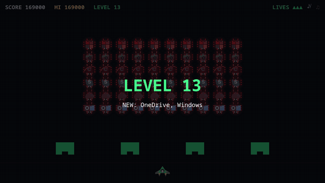

# WinVaders

<p align="center"></p>

A space-shooter mini-game for XeroLinux: defend Linux from waves of invading
Microsoft apps. Forty enemy types join the invasion as you climb, every level
gets harder, and every third level brings a boss: Clippy, Cortana, Zune, the
Blue Screen of Death, Internet Explorer, Microsoft Bob, the Red Ring of Death,
Teams, Windows Update, Kinect, the UAC prompt and Copilot, each with its own
attack and theme music. Survive them all and they come back as fusion bosses
that never end.

Inspired by: **RandyPinball**

## Install on XeroLinux only

```sh
sudo pacman -S winvaders
```
